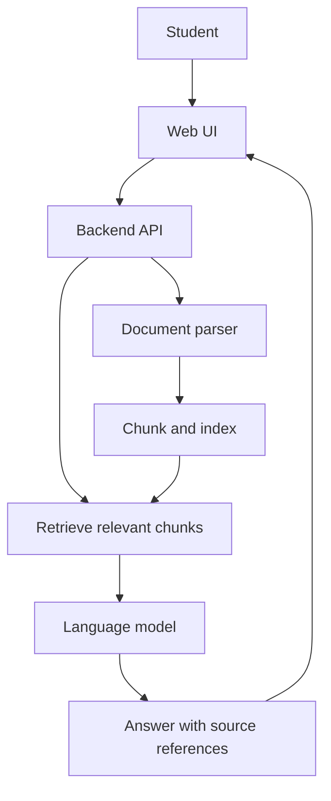

# Example: Study Notes Assistant

This is a fictional example to demonstrate the expected level of detail. It is not a recommendation to use this exact stack.

## Goal
Help a student ask questions about uploaded study notes and see answers with references to source material.

## Main flow

## Open decisions
- Which document formats must be supported?
- Can multiple students use it, and how are files isolated?
- Which model and embedding providers fit the budget and data policy?
- Is hosted vector storage needed, or is a local store enough?

## Acceptance criteria
- Users can upload supported files and get useful errors for unsupported files.
- Answers include references to retrieved source material.
- Users cannot retrieve another user's private documents.
- Provider failures are handled without exposing secrets.
- Setup and test instructions are verified and documented.

Choose technology after checking requirements, not only because it is popular.
