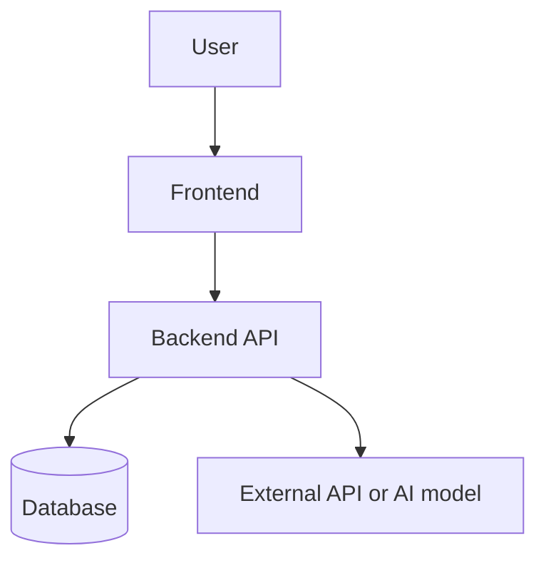
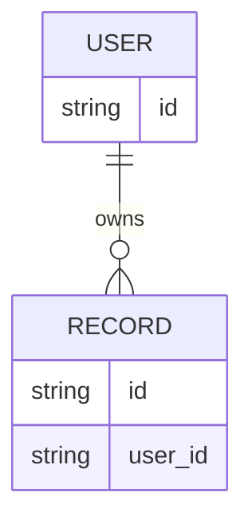

# Architecture

Keep this document aligned with the real system. Label proposed components as **planned** until they are implemented.

## Summary
[Explain the system in a few plain-English sentences.]

## System diagram

Adapt this diagram to the project.

## Components

| Component | Responsibility | Technology | Source path |
|---|---|---|---|
| Frontend | [PURPOSE] | [STACK] | [PATH] |
| Backend | [PURPOSE] | [STACK] | [PATH] |
| Database | [DATA STORED] | [DATABASE] | [CONFIG/PATH] |
| External services | [PURPOSE] | [PROVIDER] | [PATH] |

Remove irrelevant rows.

## Request and data flow
1. [Where a request starts.]
2. [Validation and business logic.]
3. [Database, model, or provider call.]
4. [Response and error handling.]

## API boundaries

| Method | Route | Purpose | Auth | Input/output |
|---|---|---|---|---|
| [METHOD] | [PATH] | [PURPOSE] | [REQUIRED?] | [SCHEMA] |

## Data model
List entities, relationships, sensitive fields, retention rules, and migrations. Add an ER diagram when it helps.

Replace example entities with the actual data model.

## Security boundaries
- Authentication and authorization: [DESIGN]
- Secrets management: [METHOD]
- Input validation: [METHOD]
- Sensitive data and retention: [POLICY]
- Rate limiting and abuse controls: [METHOD]
- Logging without secrets or private content: [METHOD]

## Runtime and deployment
[Runtime, services, environment variable names, containers, network boundaries, and hosting.]

## Failures and recovery
[Timeouts, bounded retries, provider failures, invalid input, database failures, and user-facing errors.]

## Open decisions
| Decision | Options | Choice | Reason | Status |
|---|---|---|---|---|
| [DECISION] | [OPTIONS] | [CHOICE] | [REASON] | Open / Decided |
