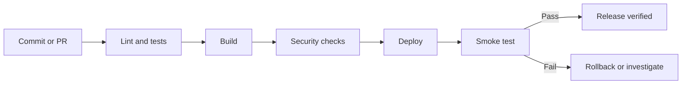

# Deployment Guide

Fill in verified instructions for the selected hosting environment. Do not say a deployment is complete until it has been checked.

## Target environment
- Host/platform: [PLATFORM]
- Environments: Local / Preview / Staging / Production
- Region: [REGION OR UNDECIDED]
- Deployment owner: [OWNER]

## Required setup

| Requirement | Purpose | Setup instructions | Variable name |
|---|---|---|---|
| [API or service] | [PURPOSE] | [OFFICIAL SETUP LINK] | [VARIABLE_NAME] |
| Database | [PURPOSE] | [SETUP LINK] | [VARIABLE_NAME] |

Keep real secret values in a secret manager or an untracked local environment file. Never place credentials in this document.

## Before deployment
- [ ] Check the provider's current deployment requirements.
- [ ] Confirm runtime and dependency versions.
- [ ] Configure environment variables and secrets.
- [ ] Check migrations, backups, and database permissions.
- [ ] Run relevant tests and the production build.
- [ ] Build the container, if applicable.
- [ ] Scan dependencies and images where supported.
- [ ] Confirm health checks, logging, timeouts, and resource needs.
- [ ] Check domain, TLS, CORS, and network access where applicable.

## CI/CD flow

Adapt this diagram to the real pipeline. Do not enable production deployment automatically unless that behavior is intended.

## Docker checks, if applicable
- Use a trusted base image and pin versions where appropriate.
- Run as a non-root user when practical.
- Keep secrets out of image layers and build arguments.
- Keep build context small with `.dockerignore`.
- Verify startup command, ports, health, permissions, and shutdown behavior.
- Build and run the image; reading the Dockerfile is not enough.

## After deployment
- [ ] Verify the health endpoint or main user journey.
- [ ] Check logs for startup and configuration errors.
- [ ] Verify critical integrations in the target environment.
- [ ] Confirm monitoring and alerts if needed.
- [ ] Record the deployed version and result.
- [ ] Confirm the rollback path.

## Rollback
[Document how to return to the last known-good release and handle database changes safely.]
