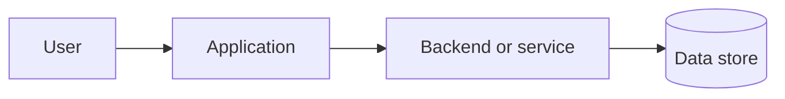

# [PROJECT_NAME]

[Explain in plain English what this project does and who it helps.]

## Why this project exists

[Describe the problem it solves.]

## How it works

[Explain the main flow in simple steps.]



Replace the example with the real system or remove it if a diagram would not help.

## Features
- [FEATURE]
- [FEATURE]

## Technology

| Part | Technology | Why it is used |
|---|---|---|
| Frontend | [TECH] | [REASON] |
| Backend | [TECH] | [REASON] |
| Database | [TECH] | [REASON] |

## Requirements
- [Runtime and version]
- [Package manager]
- [Required external services]
- [Docker or other tooling, if needed]

## Setup
1. Clone the repository.
2. Install dependencies using the commands for this project.
3. Copy `.env.example` to the appropriate local environment file.
4. Fill in required values using the setup instructions below.
5. Start required local services.
6. Run the application.

Add exact, tested commands for the real project. Never include real secret values.

## Environment variables

| Variable | Purpose | Required? | Where to get it |
|---|---|---|---|
| [VARIABLE_NAME] | [PURPOSE] | Yes / No | [PROVIDER OR LOCAL SETUP] |

Do not put credentials in this table.

## Run locally

```bash
[ACTUAL_START_COMMAND]
```

## Tests

```bash
[ACTUAL_TEST_COMMAND]
```

## Architecture and project structure

[Link to the architecture document and explain key folders.]

## Deployment

[Explain the supported deployment path and link to deployment instructions.]

## Limitations and known issues
- [VERIFIED LIMITATION OR NONE KNOWN]

## Contributing
[Explain how to propose changes and run checks.]

## License
[LICENSE]
